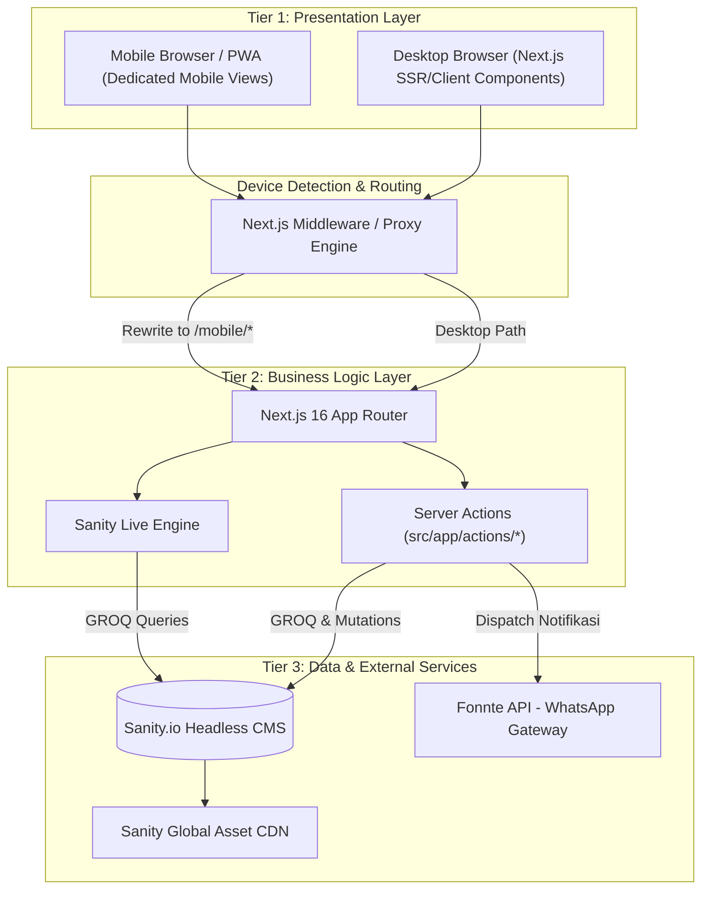
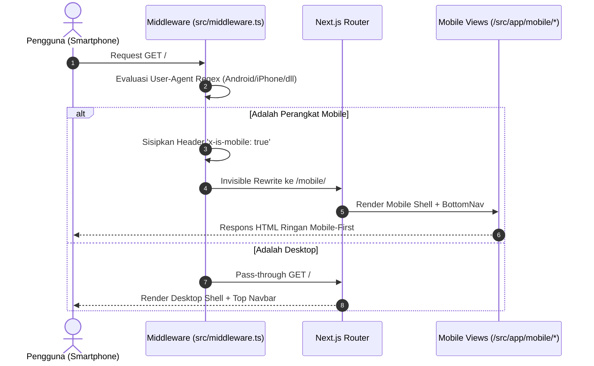
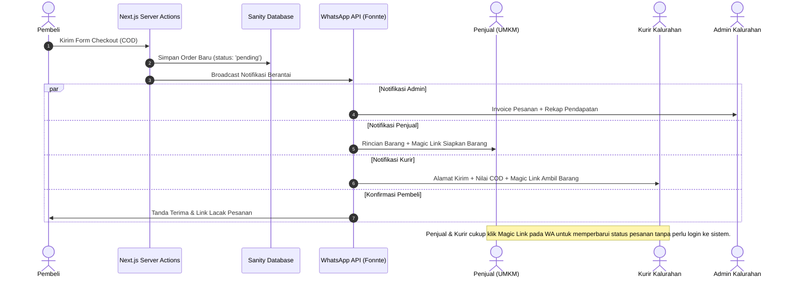

# Arsitektur Sistem PAWON 🏛️
**Pasar Warga Pondokrejo — Platform Marketplace & Layanan Kalurahan**

Dokumen ini mendokumentasikan arsitektur teknis menyeluruh dari aplikasi **PAWON**, mencakup aliran data makro, pola desain komponen, strategi multi-device (Desktop vs Mobile), integrasi sistem pihak ketiga, serta model keamanan berbasis peran.

---

## 1. Aliran Data Makro (Macro Data Flow)

Sistem PAWON mengadopsi pola arsitektur **3-Tier Modern Jamstack**:



### Penjelasan Lapisan:
1. **Presentation Layer (Next.js 16)**:
   - Menggunakan **Server-First Components** untuk katalog, berita, dan landing page demi optimasi SEO dan Core Web Vitals (LCP/CLS rendah).
   - **Client Components** dipisahkan secara terisolasi hanya untuk komponen interaktif (`CartContext`, `AddToCartButton`, `PromoBanner`, form pemesanan interaktif).
2. **Business Logic & Mutation Layer (Server Actions)**:
   - Mengeliminasi kebutuhan REST boilerplate tradisional untuk mutasi data internal.
   - Semua operasi sensitif (checkout, validasi PIN kurir/penjual, perubahan status pesanan) dijalankan di sisi server dengan token rahasia (`SANITY_API_WRITE_TOKEN`).
3. **Database & Content Layer (Sanity.io)**:
   - Sanity berfungsi sebagai database relasional berbasis dokumen JSON.
   - Data diperbarui secara instan melalui GROQ queries dan `SanityLive`.
4. **Notification Gateway (Fonnte)**:
   - Mengirim pesan WhatsApp transaksional instan ke 4 pemangku kepentingan (Admin, Penjual, Kurir, dan Pembeli).

---

## 2. Strategi Hybrid Mobile & Adaptive Rendering

PAWON melayani pengguna warga desa yang mayoritas mengakses via smartphone dengan pengalaman seperti aplikasi native:



### Karakteristik UI Mobile:
- **Bottom Navigation Bar** (`Beranda`, `Produk`, `Jasa`, `Toko`, `Keranjang`) yang cerdas: otomatis menyembunyikan diri pada halaman aksi/detail (`/product/*`, `/service/*`, `/inkubator/*`, `/order/*`, `/checkout`) menggunakan normalisasi `cleanPath` agar tidak menutupi tombol utama (*Fixed Bottom CTA* seperti *Tambah ke Keranjang*).
- Desain *touch-first* dengan area sentuh tombol minimal 48px dan pelindung z-index (`z-50`).
- PWA manifest memungkinkan aplikasi di-instal ke layar utama HP (Add to Home Screen) tanpa melalui Google Play Store.

---

## 3. Ekosistem Notifikasi Multi-Channel & Magic Link

Setiap transaksi COD memicu siklus koordinasi terintegrasi via WhatsApp:



---

## 4. Keamanan & Hak Akses Berbasis Peran (RBAC)

Sistem membagi 4 peran pengguna dengan mekanisme autentikasi yang ramah warga:

| Peran | Saluran Akses | Mekanisme Autentikasi | Kapabilitas Utama |
|---|---|---|---|
| **Admin Kalurahan** | `/admin` & `/studio` | Session Sanity / PIN Master | Verifikasi lapak UMKM, kurasi produk, manajemen kurir, monitoring seluruh pesanan |
| **Penjual (UMKM)** | `/lapak` | No. WhatsApp + PIN Toko (4-6 digit) | Toggle buka/tutup toko, tambah/edit produk, update stok, pantau pesanan masuk |
| **Kurir Kalurahan** | `/kurir` & Magic Link | No. WhatsApp + PIN Kurir (4-6 digit) | Terima tugas kirim, update status antar barang, konfirmasi penerimaan uang COD |
| **Pembeli (Warga)** | Public / Mobile View | No. WhatsApp + PIN Warga | Keranjang belanja, checkout COD/QRIS, lacak pesanan real-time, riwayat belanja |

---

## 5. Struktur Direktori Proyek

```text
pawon-pondokrejo/
├── .docs/                    # Dokumentasi arsitektur & operasional (9 file)
├── public/                   # Asset statis, logo, hero banner, PWA icons
├── scripts/                  # Script automasi Sanity (kategori, upload aset)
├── src/
│   ├── app/                  # Routing App Router Next.js
│   │   ├── actions/          # Server Actions (Mutasi DB & Integrasi WA)
│   │   ├── admin/            # Dashboard operasional admin kalurahan
│   │   ├── api/              # Route handlers REST API
│   │   ├── mobile/           # Dedicated Mobile UI (Adaptive Subpath)
│   │   ├── studio/           # Embedded Sanity Studio CMS
│   │   ├── layout.tsx        # Shell desktop root
│   │   └── page.tsx          # Beranda desktop
│   ├── components/           # Komponen UI modular
│   │   ├── Cart/             # Komponen keranjang belanja
│   │   ├── mobile/           # Komponen mobile (BottomNav)
│   │   └── ...               # ProductCard, ServiceCard, PromoBanner
│   ├── context/              # React Context (CartContext)
│   ├── sanity/               # Konfigurasi, skema dokumen, dan GROQ queries
│   └── types/                # Kontrak TypeScript global
└── next.config.ts            # Konfigurasi Next.js, Turbopack, dan PWA
```
