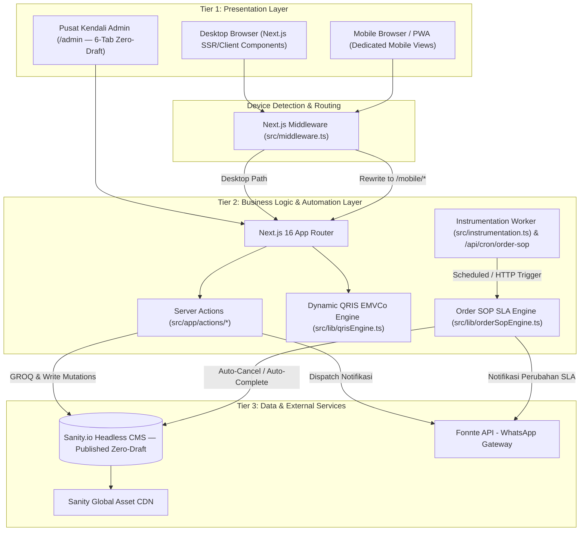
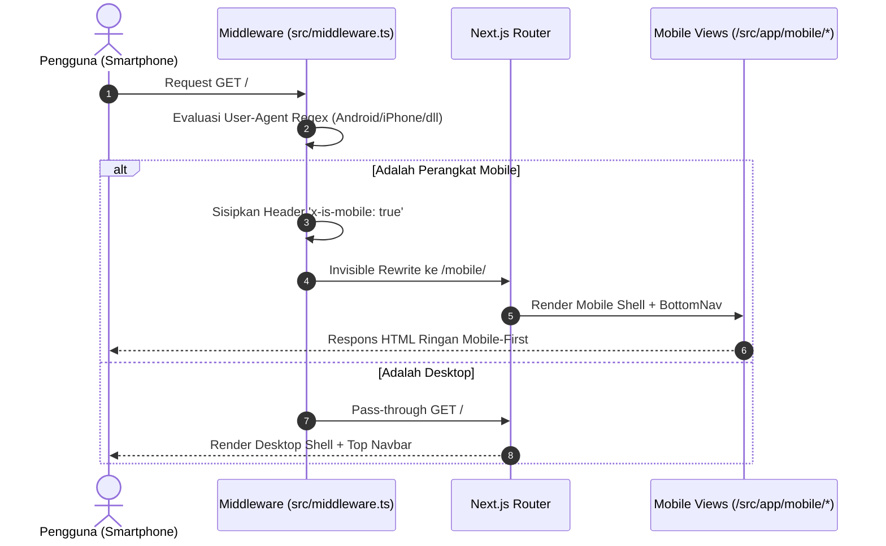

# Arsitektur Sistem PAWON 🏛️
**Pasar Warga Pondokrejo — Platform Marketplace & Layanan Kalurahan**

Dokumen ini mendokumentasikan arsitektur teknis menyeluruh dari aplikasi **PAWON**, mencakup aliran data makro, pola desain komponen, engine pembayaran Dynamic QRIS EMVCo, automasi SOP pesanan (background worker & cron), strategi multi-device (Desktop vs Mobile), integrasi WhatsApp gateway, serta model keamanan berbasis peran.

---

## 1. Aliran Data Makro (Macro Data Flow)

Sistem PAWON mengadopsi pola arsitektur **3-Tier Modern Jamstack + Server Instrumentation Worker**:



### Penjelasan Lapisan:
1. **Presentation Layer (Next.js 16)**:
   - Menggunakan **Server-First Components** untuk katalog, berita, dan landing page demi optimasi SEO dan Core Web Vitals.
   - **Client Components** terisolasi untuk interaktivitas (`CartContext`, `DynamicQrisCard`, `AdminOrdersTab`, `VendorDashboard`, `CourierDashboard`, dll).
2. **Business Logic, Payment & Automation Layer**:
   - **Server Actions (`src/app/actions/*`)**: Pusat mutasi Sanity memakai `SANITY_API_WRITE_TOKEN` (termasuk Zero-Draft Admin Center di `/admin`).
   - **Dynamic QRIS Engine (`src/lib/qrisEngine.ts`)**: Parser TLV & generator string QRIS dinamis standar EMVCo (injeksi Tag `54` nominal tepat + CRC-16/CCITT-FALSE Tag `63`).
   - **Order SOP Engine & Worker (`src/lib/orderSopEngine.ts`, `src/lib/courierAssigner.ts`, `src/instrumentation.ts`, `src/app/api/cron/order-sop/route.ts`)**: Seleksi kurir bergiliran (**Round-Robin** via `lastAssignedAt`), pengalihan otomatis kurir tidak merespons (`runCourierTimeoutCheck()` setiap 1 menit di production), serta penutupan otomatis pesanan kedaluwarsa (`pending`/`processing` batal, `delivered` selesai setiap 10 menit). Nonaktif otomatis di Local Dev (`NODE_ENV !== 'production'`).
3. **Database & Content Layer (Sanity.io)**:
   - Dokumen JSON terindeks dan langsung berstatus **Published (Zero-Draft)** untuk order, vendor, kurir, produk, jasa, artikel, dan `appSettings`.
4. **Notification Gateway (Fonnte)**:
   - Broadcast pesan WhatsApp transaksional otomatis ke 4 pemangku kepentingan (Admin, Penjual, Kurir, Pembeli) dengan normalisasi nomor `628...`.

---

## 2. Strategi Hybrid Mobile & Adaptive Rendering

PAWON melayani warga desa yang mayoritas mengakses via smartphone dengan pengalaman layaknya aplikasi native:



### Karakteristik UI Mobile:
- **Bottom Navigation Bar** (`Beranda`, `Produk`, `Jasa`, `Toko`, `Keranjang`) otomatis tersembunyi pada halaman detail/aksi/checkout (`/product/*`, `/service/*`, `/inkubator/*`, `/order/*`, `/checkout`) via `cleanPath` agar tidak menutupi *Fixed Bottom CTA* (`z-50`).
- Dukungan testing via Wi-Fi LAN (`allowedDevOrigins` di `next.config.ts`) dengan port pengembangan `3333`.
- Manifest PWA untuk instalasi cepat (Add to Home Screen).

---

## 3. Pusat Kendali Admin Zero-Draft (`/admin`) & Dynamic QRIS

- `/admin` menyediakan 6 tab operasional langsung menulis dokumen *published* (bypass sistem `drafts.*` Sanity Studio):
  1. **Pesanan**: KPI interaktif, pengelompokan periode (`Bulan > Minggu > Hari`), tampilan Tabel vs Kartu, 5-stage progress stepper, rincian subtotal + ongkir, 3-way WA links, CSV export, dan kontrol **SOP Otomatis** (`Dry-Run` & `Eksekusi`).
  2. **Mitra & Warga**: CRUD `vendor`, `courier`, `customer` (termasuk status aktif, verifikasi, PIN portal, skor COD).
  3. **Katalog & Kategori**: CRUD `product`, `service`, `category` + upload gambar ke Sanity Asset CDN.
  4. **Konten & Banner**: CRUD `banner` (desktop/mobile) dan `article`.
  5. **Inkubator UMKM**: CRUD `incubatorService` dan konfigurasi `incubatorSettings`.
  6. **Pengaturan & QRIS**: Konfigurasi nomor WA Admin Pusat (`adminPhone`), ongkir default (`defaultShippingFee`), **Dynamic QRIS Settings** (`isQrisEnabled`, `qrisMerchantName`, `qrisNmid`, `qrisStaticPayload` + preview CRC-16 live), dan **Order SOP Rules** (`isSopAutoEnabled`, ambang SLA jam, `sopLastRunAt`).

---

## 4. Ekosistem Notifikasi WhatsApp & Alur Transaksi Otomatis

- **Pesanan COD (Otomatis Penuh — Admin Log-Only)**: Pembeli checkout → status langsung `processing` → sistem memfilter item per lapak untuk **Penjual** + menugaskan **Kurir Round-Robin** (dengan tombol *Terima Order* & *Tolak Order* serta auto-skip jika melewati batas menit respons) → **Admin** hanya menerima log progres di WA tanpa perlu menekan tautan.
- **Pesanan QRIS (Hybrid 1-Klik Admin)**: Pembeli checkout (`pending`) → **Admin** menerima 1 tautan verifikasi mutasi → setelah diklik *Konfirmasi Lunas*, pesanan otomatis diteruskan ke **Penjual** & **Kurir Round-Robin** persis seperti COD.
- **Keamanan & Copy Bersih**: Seluruh pesan WA diformat teks bersih (0 emoji mentah, 0 istilah teknis/database) dan tautan aksi diamankan HMAC token `?k=...` (`src/lib/actionToken.ts`).
- **Siklus Status**: `pending` → `processing` → `accepted` → `shipped` → `delivering` → `delivered` → `completed` / `cancelled` / `problem` (seluruh isu `ISS-005` s.d. `ISS-010` sudah selesai).

---

## 5. Keamanan & Hak Akses Berbasis Peran (RBAC)

| Peran | Saluran Akses | Mekanisme Autentikasi | Kapabilitas Utama |
|---|---|---|---|
| **Admin Kalurahan** | `/admin` & `/studio` | PIN Admin (`appSettings.adminPin`) / Sanity Session | Kelola pesanan, tugaskan kurir, kelola mitra/katalog/konten, atur QRIS & SOP SLA |
| **Penjual (UMKM)** | `/lapak` | No. WhatsApp + PIN Toko | Toggle buka/tutup toko, CRUD produk & jasa |
| **Kurir Kalurahan** | `/kurir` & Magic Link | No. WhatsApp + PIN Kurir | Toggle aktif bertugas, lihat tugas pengantaran, update status kirim & COD |
| **Pembeli (Warga)** | Public / Mobile View / `/track` | No. WhatsApp + PIN Warga | Keranjang, checkout COD/Dynamic QRIS, lacak pesanan, konfirmasi terima pesanan |

---

## 6. Struktur Direktori Proyek

```text
pawon-pondokrejo/
├── .docs/                    # Single Source of Truth dokumentasi teknis (9 file)
├── public/                   # Asset statis, logo, hero banner, PWA icons, APK
├── scripts/                  # Script utilitas Sanity (sync-categories, upload-covers)
├── temp/                     # Arsip dokumentasi & skrip lama yang dipensiunkan
├── src/
│   ├── __tests__/            # Test suite Vitest (qrisEngine, orderSopEngine, cart, workflowSync)
│   ├── app/                  # Next.js 16 App Router
│   │   ├── actions/          # Server Actions (13 modul transaksi, portal & admin CRUD)
│   │   ├── admin/            # Pusat Kendali Admin 6-tab zero-draft
│   │   ├── api/              # REST endpoints (/api/version, /api/debug-couriers, /api/cron/order-sop)
│   │   ├── kurir/            # Portal Kurir
│   │   ├── lapak/            # Portal UMKM
│   │   ├── mobile/           # Dedicated Mobile UI (Adaptive Subpath)
│   │   ├── studio/           # Embedded Sanity Studio CMS
│   │   ├── layout.tsx        # Shell desktop root
│   │   └── page.tsx          # Beranda desktop
│   ├── components/           # Komponen UI modular (Cart, DynamicQrisCard, BottomNav, dll)
│   ├── context/              # React Context (CartContext)
│   ├── lib/                  # Core engines (qrisEngine.ts, orderSopEngine.ts)
│   ├── sanity/               # Schema types, GROQ queries, client, image & WhatsApp helper
│   ├── types/                # Kontrak TypeScript global
│   ├── instrumentation.ts    # Startup hook background worker SOP (aktif di production)
│   └── middleware.ts         # Hybrid device detection & mobile subpath rewrite
└── next.config.ts            # Konfigurasi Next.js, Turbopack, LAN dev origins, dan PWA
```
