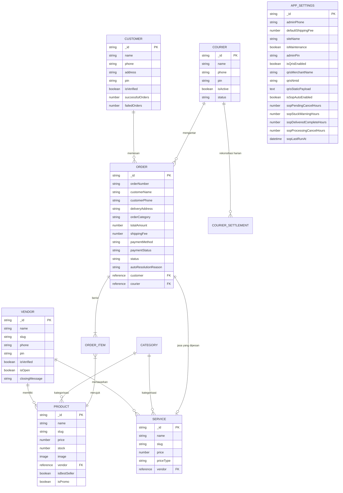

# Skema Database & Model Konten Sanity 🗄️
**Pasar Warga Pondokrejo — Desain Skema Dokumen & GROQ Queries**

Aplikasi PAWON menggunakan **Sanity.io** sebagai *headless content & document store* (`projectId: i5mr5ihx`, `dataset: production`). Seluruh entitas ditulis dalam mode **Published (Zero-Draft)** untuk memastikan sinkronisasi langsung antara `/admin`, `/lapak`, `/kurir`, dan etalase warga.

---

## 1. Diagram Relasi Dokumen (Document ERD)

---

## 2. Katalog Skema Dokumen (`src/sanity/schemaTypes/*`)

### 1. `product` (`productType.ts`)
- `name` (String, Required), `slug` (Slug, Required), `price` (Number, Required, min: 0), `stock` (Number, Required, min: 0)
- `image` (Image w/ Hotspot, Required), `description` (Text)
- `vendor` (Reference → `vendor`, Required), `categories` (Array of Reference → `category`)
- `isBestSeller` (Boolean), `isPromo` (Boolean), `promoDiscount` (Number, 0–100%)

### 2. `service` (`serviceType.ts`)
- `name` (String, Required), `slug` (Slug, Required), `price` (Number, Required)
- `priceType` (String: `fixed` | `starting_from` | `hourly` | `negotiable`)
- `vendor` (Reference → `vendor`, Required), `categories` (Array of Reference → `category`), `image` (Image, Required)

### 3. `vendor` (`vendorType.ts`)
- `name` (String, Required), `slug` (Slug, Required), `phone` (String, Required), `address` (Text)
- `pin` (String, 4–6 digit, untuk login `/lapak`), `isVerified` (Boolean), `isOpen` (Boolean), `closingMessage` (String)
- `latitude` (Number), `longitude` (Number): Koordinat lokasi lapak UMKM di peta wilayah Pondokrejo.

### 4. `courier` (`courierType.ts`)
- `name` (String, Required), `phone` (String, Required), `pin` (String, 4–6 digit, untuk login `/kurir`)
- `isActive` (Boolean), `statusMessage` (String), `status` (`active` | `inactive`)
- `lastAssignedAt` (Datetime, ReadOnly): Stempel waktu giliran Round-Robin terakhir kurir menerima tugas.
- `customFloatCash` (Number, Opsional): Override kas awal kurir bila berbeda dari default `Rp100.000`.
- `isSettlementBlocked` (Boolean, ReadOnly), `settlementBlockedReason` (String, ReadOnly), `lastSettledAt` (Datetime, ReadOnly): Penanda pembekuan otomatis antrean bila laporan kas tertunda `> 48 jam` (`2x24 jam`).

### 5. `customer` (`customerType.ts`)
- `name` (String, Required), `phone` (String, Required), `address` (Text, Required)
- `pin` (String), `isVerified` (Boolean), `successfulOrders` (Number), `failedOrders` (Number)

### 6. `order` (`orderType.ts`, Live Edit: true)
- `orderNumber` (String, ReadOnly — format `ORD-XXXXXX`)
- `customerName`, `customerPhone`, `deliveryAddress` (String/Text, Required), `customer` (Reference → `customer`, Required)
- `orderCategory` (`product` | `service`), `serviceItem` (Reference → `service`), `serviceDate` (Datetime)
- `items` (Array of Object: `product` Ref, `quantity`, `price`)
- `totalAmount` (Number), `shippingFee` (Number)
- **Snapshot Finansial**: `productSubtotal` (Number), `courierCommissionAmount` (Number), `kalurahanFeeAmount` (Number), `completedAt` (Datetime), `exceededFloatCash` (Boolean), `settlementId` (String).
- `paymentMethod` (`cod` | `qris`), `paymentStatus` (`unpaid` | `paid`)
- `status`: `pending` | `accepted` | `processing` | `shipped` | `delivering` | `delivered` | `completed` | `cancelled` | `problem`
- `courier` (Reference → `courier`), `courierNotes` (Text), `vendorId_for_query_only` (String, hidden)
- `autoResolutionReason` (String, ReadOnly), `courierOfferedAt` (Datetime, ReadOnly), `rejectedCourierIds` (Array of String, ReadOnly).

### 7. `appSettings` (`appSettingsType.ts`)
- **Identitas & Tarif Operasional**:
  - `adminPhone` (String, Required), `siteName` (String, initial: `PAWON PONDOKREJO`), `isMaintenance` (Boolean), `adminPin` (String).
  - `defaultShippingFee` (Number, initial: `6000`): Ongkir pembeli flat kalurahan.
  - `courierCommissionAmount` (Number, initial: `4000`): Upah kurir per pesanan selesai.
  - `kalurahanFeeAmount` (Number, initial: `2000`): Porsi kas Kalurahan/PAWON per pesanan selesai.
  - `defaultCourierFloatCash` (Number, initial: `100000`): Kas awal harian tiap kurir.
  - `dailySettlementCutoffHour` (Number, initial: `16`): Jam tutup buku harian WIB (`16:00 WIB`).
  - `maxSettlementDelayHours` (Number, initial: `48`): Batas tunda maksimal (`2x24 jam`) sebelum kurir dibekukan.
  - `financeLedgerStartedAt` (Datetime): Batas awal aktivasi buku kas kurir (order sebelum stempel ini diabaikan).
- **Dynamic QRIS EMVCo Settings**:
  - `isQrisEnabled` (Boolean), `qrisMerchantName` (String), `qrisNmid` (String), `qrisStaticPayload` (Text, validasi `validateCRC16`).
- **Order SOP & SLA Settings**:
  - `isSopAutoEnabled` (Boolean), `sopPendingCancelHours` (`24`), `sopStuckWarningHours` (`4`), `sopDeliveredCompleteHours` (`24`), `sopProcessingCancelHours` (`48`), `sopCourierTimeoutMinutes` (`5`), `sopLastRunAt` (Datetime, ReadOnly).

### 8. `courierSettlement` (`courierSettlementType.ts`)
- Buku laporan kas harian per kurir per periode (`settlement-<courierId>-YYYY-MM-DD`):
  - `periodKey`, `courier` (Reference → `courier`), `courierName`, `courierPhone`, `cutoffAt`, `dueAt`
  - `openingFloatCash`, `orderCount`, `orderNumbers`, `codOrderTotal`, `qrisOrderTotal`, `sellerCashPaid`, `courierCommissionTotal`, `kalurahanFeeTotal`, `endingCashInHand`, `kurirOutOfPocket`, `netContinueNextDay`, `netFullClose`
  - `settlementMode` (`continue_float` | `full_return`), `status` (`waiting_settlement` | `overdue_warning` | `blocked_overdue` | `settled`), `warning24SentAt`, `blocked48SentAt`, `settledAt`, `settledAmount`, `notes`.

### 9. Skema Pendukung Lainnya
- `category` (`categoryType.ts`), `banner` (`bannerType.ts`), `article` (`articleType.ts`)
- `incubatorService` (`incubatorServiceType.ts`), `incubatorSettings` (`incubatorSettingsType.ts`)

---

## 3. GROQ Queries Utama (`src/sanity/lib/queries.ts`)

1. **Katalog Produk Beranda (`PRODUCTS_QUERY`)**: Mengambil produk beserta proyeksi `vendor` dan `categories`.
2. **Kategori Dinamis (`CATEGORIES_QUERY`)**: Menghitung `productCount` dan `serviceCount` via `count(*[references(^._id)])`.
3. **Konfigurasi Global (`APP_SETTINGS_QUERY`)**: Mengambil pengaturan `appSettings` (kontak admin, tarif `6000/4000/2000`, kas `100000`, cutoff `16`, batas `48`, `financeLedgerStartedAt`, QRIS config, dan SOP SLA).
4. **Pelacakan & Admin (`ORDER_BY_NUMBER_QUERY`, Dashboard Queries)**: Menampilkan detail pesanan lengkap (termasuk `courierOfferedAt` untuk menyembunyikan nama kurir antrean sebelum diterima).
