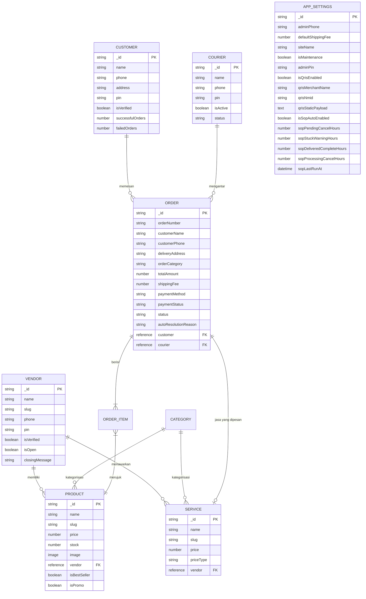

# Skema Database & Model Konten Sanity 🗄️
**Pasar Warga Pondokrejo — Desain Skema Dokumen & GROQ Queries**

Aplikasi PAWON menggunakan **Sanity.io** sebagai *headless content & document store* (`projectId: i5mr5ihx`, `dataset: production`). Seluruh entitas ditulis dalam mode **Published (Zero-Draft)** untuk memastikan sinkronisasi langsung antara `/admin`, `/lapak`, `/kurir`, dan etalase warga.

---

## 1. Diagram Relasi Dokumen (Document ERD)

---

## 2. Katalog Skema Dokumen (`src/sanity/schemaTypes/*`)

### 1. `product` (`productType.ts`)
- `name` (String, Required), `slug` (Slug, Required), `price` (Number, Required, min: 0), `stock` (Number, Required, min: 0)
- `image` (Image w/ Hotspot, Required), `description` (Text)
- `vendor` (Reference → `vendor`, Required), `categories` (Array of Reference → `category`)
- `isBestSeller` (Boolean), `isPromo` (Boolean), `promoDiscount` (Number, 0–100%)

### 2. `service` (`serviceType.ts`)
- `name` (String, Required), `slug` (Slug, Required), `price` (Number, Required)
- `priceType` (String: `fixed` | `starting_from` | `hourly` | `negotiable`)
- `vendor` (Reference → `vendor`, Required), `categories` (Array of Reference → `category`), `image` (Image, Required)

### 3. `vendor` (`vendorType.ts`)
- `name` (String, Required), `slug` (Slug, Required), `phone` (String, Required), `address` (Text)
- `pin` (String, 4–6 digit, untuk login `/lapak`), `isVerified` (Boolean), `isOpen` (Boolean), `closingMessage` (String)

### 4. `courier` (`courierType.ts`)
- `name` (String, Required), `phone` (String, Required), `pin` (String, 4–6 digit, untuk login `/kurir`)
- `isActive` (Boolean), `statusMessage` (String), `status` (`active` | `inactive`)
- `lastAssignedAt` (Datetime, ReadOnly): Stempel waktu giliran Round-Robin terakhir kurir menerima tugas.

### 5. `customer` (`customerType.ts`)
- `name` (String, Required), `phone` (String, Required), `address` (Text, Required)
- `pin` (String), `isVerified` (Boolean), `successfulOrders` (Number), `failedOrders` (Number)

### 6. `order` (`orderType.ts`, Live Edit: true)
- `orderNumber` (String, ReadOnly — format `ORD-XXXXXX`)
- `customerName`, `customerPhone`, `deliveryAddress` (String/Text, Required), `customer` (Reference → `customer`, Required)
- `orderCategory` (`product` | `service`), `serviceItem` (Reference → `service`), `serviceDate` (Datetime)
- `items` (Array of Object: `product` Ref, `quantity`, `price`)
- `totalAmount` (Number), `shippingFee` (Number)
- `paymentMethod` (`cod` | `qris`), `paymentStatus` (`unpaid` | `paid`)
- `status`: `pending` | `accepted` | `processing` | `shipped` | `delivering` | `delivered` | `completed` | `cancelled` | `problem`
- `courier` (Reference → `courier`), `courierNotes` (Text), `vendorId_for_query_only` (String, hidden)
- `autoResolutionReason` (String, ReadOnly): Alasan penutupan otomatis oleh Order SOP Engine (misal: melewati batas jam pending/processing/delivered).
- `courierOfferedAt` (Datetime, ReadOnly): Waktu penawaran antrean Round-Robin ke kurir aktif saat ini (untuk mekanisme auto-skip).
- `rejectedCourierIds` (Array of String, ReadOnly): Daftar ID kurir yang sudah menolak atau terlewati batas waktu pada order ini.

### 7. `appSettings` (`appSettingsType.ts`)
- **Identitas & Operasional Dasar**:
  - `adminPhone` (String, Required): Nomor WA Admin Pusat penerima notifikasi transaksi.
  - `defaultShippingFee` (Number, initial: `5000`): Biaya ongkir standar kalurahan.
  - `siteName` (String, initial: `PAWON PONDOKREJO`), `isMaintenance` (Boolean)
  - `adminPin` (String): PIN autentikasi dasbor `/admin` *(dikonfigurasi aman di Sanity `appSettings`)*.
- **Dynamic QRIS EMVCo Settings**:
  - `isQrisEnabled` (Boolean, initial: `true`): Saklar aktif/nonaktif metode pembayaran QRIS di checkout.
  - `qrisMerchantName` (String, max 25 karakter, initial: `PAWON PONDOKREJO`).
  - `qrisNmid` (String, initial: `ID1026574925990`).
  - `qrisStaticPayload` (Text, validasi kustom `validateCRC16`): String QRIS Statis resmi yang dikonversi otomatis ke QRIS Dinamis per pesanan.
- **Order SOP & SLA Settings**:
  - `isSopAutoEnabled` (Boolean, initial: `true`): Saklar utama worker SOP otomatis.
  - `sopPendingCancelHours` (Number, initial: `24`): Batas jam batal otomatis pesanan `pending`.
  - `sopStuckWarningHours` (Number, initial: `4`): Batas jam penanda peringatan pesanan macet di `/admin`.
  - `sopDeliveredCompleteHours` (Number, initial: `24`): Batas jam selesai otomatis setelah `delivered`.
  - `sopProcessingCancelHours` (Number, initial: `48`): Batas jam batal otomatis pesanan `accepted`/`processing`/`shipped`/`delivering` yang macet.
  - `sopCourierTimeoutMinutes` (Number, initial: `5`): Batas menit respons kurir Round-Robin sebelum dialihkan otomatis ke kurir berikutnya.
  - `sopLastRunAt` (Datetime, ReadOnly): Stempel waktu eksekusi worker SOP terakhir.

### 8. Skema Pendukung Lainnya
- `category` (`categoryType.ts`), `banner` (`bannerType.ts`), `article` (`articleType.ts`)
- `incubatorService` (`incubatorServiceType.ts`), `incubatorSettings` (`incubatorSettingsType.ts`)

---

## 3. GROQ Queries Utama (`src/sanity/lib/queries.ts`)

1. **Katalog Produk Beranda (`PRODUCTS_QUERY`)**: Mengambil produk beserta proyeksi `vendor` dan `categories`.
2. **Kategori Dinamis (`CATEGORIES_QUERY`)**: Menghitung `productCount` dan `serviceCount` via `count(*[references(^._id)])`.
3. **Konfigurasi Global (`APP_SETTINGS_QUERY`)**: Mengambil seluruh pengaturan `appSettings` (kontak admin, ongkir, QRIS config, dan SOP SLA config) untuk dipakai checkout, cart, inkubator, serta worker SOP.
4. **Pelacakan & Admin (`ORDER_BY_NUMBER_QUERY`, Dashboard Queries)**: Menampilkan detail pesanan lengkap dengan relasi `customer`, `courier`, `items[].product`, dan `autoResolutionReason`.
