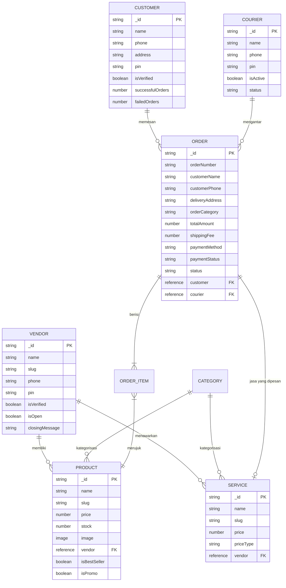

# Skema Database & Model Konten Sanity 🗄️
**Pasar Warga Pondokrejo — Desain Skema Dokumen & GROQ Queries**

Aplikasi PAWON menggunakan **Sanity.io** sebagai *headless content & document store*. Database ini menyimpan entitas marketplace, jasa warga, portal kurir, direktori UMKM, dan manajemen pesanan berbasis dokumen JSON dengan relasi referensial terindeks.

---

## 1. Diagram Relasi Dokumen (Document ERD)



---

## 2. Katalog Skema Dokumen (`src/sanity/schemaTypes/*`)

### 1. `product` (Produk UMKM)
- **Tipe**: Document (File: `productType.ts`)
- **Field Utama**:
  - `name` (String, Required): Nama produk.
  - `slug` (Slug, Required): URL-friendly slug dari nama produk.
  - `price` (Number, Required, min: 0): Harga satuan dalam Rupiah.
  - `stock` (Number, Required, min: 0): Jumlah ketersediaan stok fisik.
  - `image` (Image, Required): Foto produk (mendukung Hotspot).
  - `description` (Text): Uraian spesifikasi, bahan, dan deskripsi produk.
  - `vendor` (Reference ke `vendor`, Required): Lapak UMKM pemilik produk.
  - `categories` (Array of References ke `category`): Label kategori produk.
  - `isBestSeller` (Boolean): Penanda produk unggulan/terlaris di beranda.
  - `isPromo` (Boolean): Penanda produk sedang dalam potongan harga spesial.
  - `promoDiscount` (Number, 0-100%): Persentase diskon potongan harga.

### 2. `service` (Layanan Jasa Warga)
- **Tipe**: Document (File: `serviceType.ts`)
- **Field Utama**:
  - `name` (String, Required): Nama layanan (misal: Servis AC, Pijat Bayi, Instalasi WiFi).
  - `slug` (Slug, Required): Slug URL layanan.
  - `price` (Number, Required): Tarif acuan.
  - `priceType` (String: `fixed` | `starting_from` | `hourly` | `negotiable`): Tipe penetapan tarif (Tarif Tetap, Mulai Dari, Per Jam, Nego).
  - `vendor` (Reference ke `vendor`, Required): Profil warga penyedia layanan.
  - `categories` (Array of References ke `category`).
  - `image` (Image, Required): Portofolio atau foto representasi jasa.

### 3. `vendor` (Lapak / Profil UMKM)
- **Tipe**: Document (File: `vendorType.ts`)
- **Field Utama**:
  - `name` (String, Required): Nama usaha/toko.
  - `slug` (Slug, Required): Slug identitas toko (`/vendor/[slug]`).
  - `phone` (String, Required): Nomor WhatsApp utama pelaku usaha.
  - `address` (Text): Alamat lapak / tempat tinggal di Kalurahan Pondokrejo.
  - `pin` (String, 4-6 digit): PIN login akses portal lapak mandiri (`/lapak`).
  - `isVerified` (Boolean): Status verifikasi kelayakan oleh Admin Kalurahan.
  - `isOpen` (Boolean): Saklar operasional toko (buka atau tutup sementara).
  - `closingMessage` (String): Pesan khusus saat lapak sedang tutup.

### 4. `courier` (Kurir Logistik Kalurahan)
- **Tipe**: Document (File: `courierType.ts`)
- **Field Utama**:
  - `name` (String, Required): Nama petugas kurir.
  - `phone` (String, Required): Nomor WhatsApp aktif untuk notifikasi tugas.
  - `pin` (String, 4-6 digit): PIN keamanan masuk portal kurir (`/kurir`).
  - `isActive` (Boolean): Status ketersediaan tugas pengantaran.
  - `statusMessage` (String): Alasan saat kurir sedang libur/tidak aktif.
  - `status` (String: `active` | `inactive`).

### 5. `customer` (Profil Warga Pembeli)
- **Tipe**: Document (File: `customerType.ts`)
- **Field Utama**:
  - `name` (String, Required): Nama warga.
  - `phone` (String, Required, Unique): Nomor WhatsApp warga.
  - `address` (Text, Required): Alamat rumah warga untuk pengantaran.
  - `pin` (String, initial: `123456`): PIN akses riwayat belanja.
  - `isVerified` (Boolean): Validitas identitas warga oleh kalurahan.
  - `successfulOrders` (Number): Akumulasi order COD berhasil diselesaikan.
  - `failedOrders` (Number): Akumulasi order fiktif / dibatalkan (fraud protection).

### 6. `order` (Transaksi Pesanan)
- **Tipe**: Document (File: `orderType.ts`, Live Edit: true)
- **Field Utama**:
  - `orderNumber` (String, ReadOnly): Kode referensi transaksi unik (`ORD-XXXXXX`).
  - `customerName` & `customerPhone` & `deliveryAddress` (String & Text, Required).
  - `customer` (Reference ke `customer`, Required).
  - `orderCategory` (String: `product` | `service`): Jenis transaksi.
  - `serviceItem` (Reference ke `service`, kondisional bila jasa).
  - `serviceDate` (Datetime, jadwal pelaksanaan jasa).
  - `items` (Array of Object): Daftar barang pesanan (referensi `product`, `quantity`, `price`).
  - `totalAmount` (Number): Total biaya barang.
  - `shippingFee` (Number): Biaya ongkir flat kalurahan.
  - `paymentMethod` (String: `cod` | `qris`).
  - `paymentStatus` (String: `unpaid` | `paid`).
  - `status` (String): Siklus hidup pesanan:
    - `pending` (Menunggu konfirmasi)
    - `accepted` (Disanggupi penjual/penyedia jasa)
    - `processing` (Sedang disiapkan)
    - `shipped` (Diserahkan ke kurir)
    - `delivering` (Kurir dalam perjalanan menuju alamat)
    - `delivered` (Barang sampai di lokasi)
    - `completed` (Pembayaran COD diterima, pesanan tuntas)
    - `cancelled` (Dibatalkan)
    - `problem` (Ada kendala alamat / stok / penolakan)
  - `courier` (Reference ke `courier`): Kurir yang ditugaskan.
  - `courierNotes` (Text): Instruksi khusus dari admin.

### 7. Skema Pendukung Lainnya
- `category` (`categoryType.ts`): Kategori klasifikasi produk dan jasa.
- `banner` (`bannerType.ts`): Slider promosi beranda (gambar desktop & mobile terpisah).
- `article` (`articleType.ts`): Berita kalurahan, info UMKM, dan panduan BUMKal.
- `appSettings` (`appSettingsType.ts`): Konfigurasi global (Nomor WA Admin Kalurahan, flat ongkir).
- `incubatorService` & `incubatorSettings`: Layanan inkubator bisnis warga (legalitas, perizinan, desain kemasan).

---

## 3. GROQ Queries Utama (`src/sanity/lib/queries.ts`)

1. **Katalog Produk Beranda**:
   ```groq
   *[_type == "product" && (!defined($search) || name match $search + "*")] | order(_createdAt desc) {
     _id, name, "slug": slug.current, price, stock, image, isBestSeller, isPromo, promoDiscount,
     "vendor": vendor->{ name, "slug": slug.current, isVerified },
     "categories": categories[]->{ name, "slug": slug.current }
   }
   ```
2. **Kategori dengan Hitungan Relasi Real-time**:
   ```groq
   *[_type == "category"] | order(name asc) {
     _id, name, "slug": slug.current, image,
     "productCount": count(*[_type == "product" && references(^._id)]),
     "serviceCount": count(*[_type == "service" && references(^._id)])
   }
   ```
3. **Pelacakan Pesanan Berdasarkan Nomor Tracking**:
   ```groq
   *[_type == "order" && orderNumber == $orderNumber][0] {
     _id, orderNumber, status, paymentMethod, paymentStatus, totalAmount, shippingFee,
     customerName, customerPhone, deliveryAddress, _createdAt,
     "courier": courier->{ name, phone },
     "items": items[]{ quantity, price, "product": product->{ name, image, "slug": slug.current } }
   }
   ```
